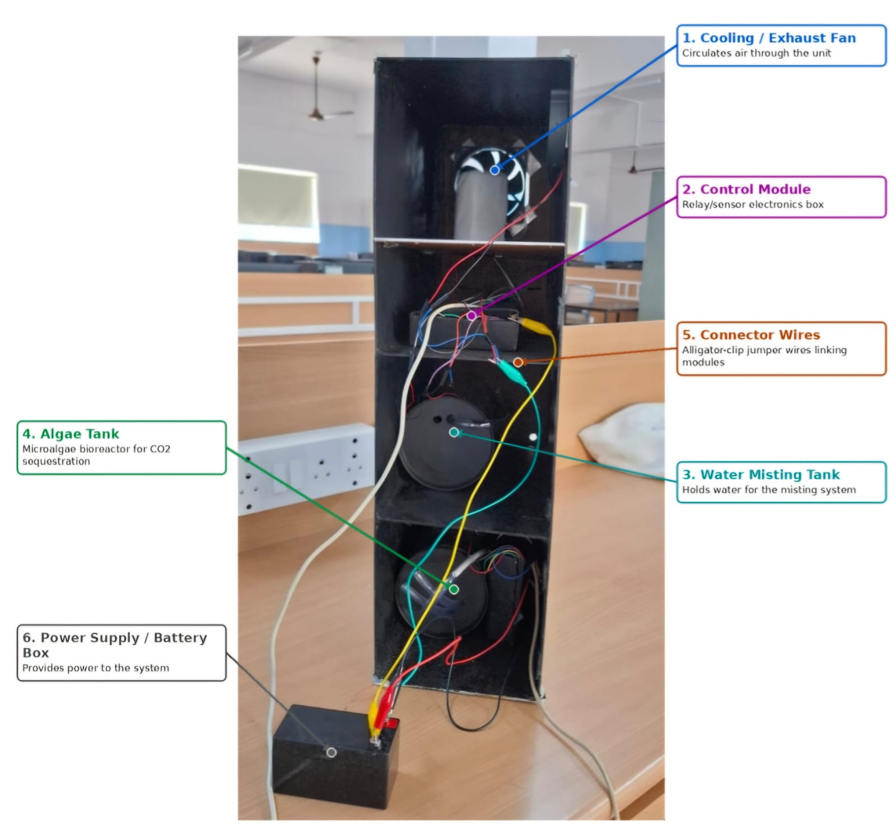
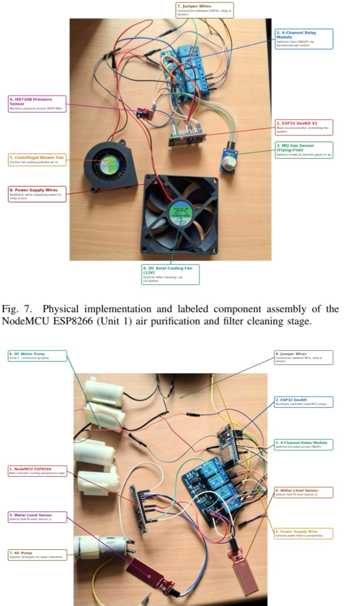
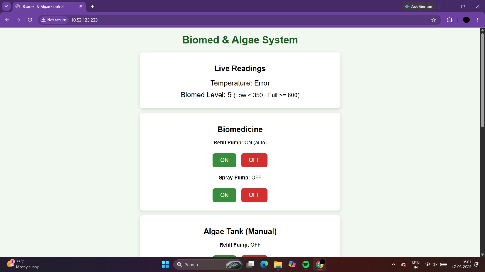

# DustVigil — Smart Air Pollution Control System

**An IoT-based prototype for air-quality monitoring, automated ventilation, filter-cleaning control, and water management.**

DustVigil is a hardware prototype developed to explore how sensor-based automation can support air pollution control in construction-site environments. The system uses ESP8266 microcontrollers, sensor inputs, relay-controlled devices, and browser-based dashboards to monitor readings and control selected functions.

The project is divided into two controller modules: an air-quality and filter-maintenance controller, and a water-level and misting controller.

## Project Overview



DustVigil explores an integrated approach to air pollution management through:

- Sensor-based air-quality readings.
- Pressure-based filter-maintenance logic.
- Automated fan and spray-pump control.
- Water-level monitoring and refill control.
- Web dashboards for monitoring and manual operation.
- Automatic and manual operating modes.

## System Architecture

DustVigil currently consists of two independently programmed ESP8266 controller modules.

### 1. Air Quality and Filter-Maintenance Controller

**Source file:** `code/part1_part2.ino`

This module combines gas-sensor readings, differential-pressure readings, ventilation control, and filter-cleaning control.

**Components and functions**

- ESP8266 NodeMCU microcontroller.
- MQ-series gas sensor module connected to analog input A0.
- HX710B differential-pressure module.
- Two relay-controlled fans for ventilation and cleaning.
- Relay-controlled spray pump.
- Relay-controlled refill pump with manual control.
- Asynchronous web server for the dashboard.

**Control logic**

- Reads the gas-sensor analog value and averages multiple readings.
- Reads raw values from the HX710B module.
- Uses configurable thresholds to control the ventilation fan, spray pump, and cleaning fan in automatic mode.
- Provides manual ON/OFF controls through a browser dashboard.
- Displays sensor readings, device statuses, and the selected operating mode.



### 2. Water-Level and Misting Controller

**Source file:** `code/part3.ino`

This module focuses on water-level monitoring and control of the spray and refill pumps.

**Components and functions**

- ESP8266 NodeMCU microcontroller.
- Analog water-level sensor connected to A0.
- Relay-controlled spray pump.
- Relay-controlled refill pump.
- Browser-based monitoring and control dashboard.
- Automatic and manual operating-mode selection.

**Control logic**

- Reads the analog water-level value.
- Uses configurable low and high thresholds to determine when the spray or refill pump should operate in automatic mode.
- Provides browser controls for manually operating both pumps.
- Displays water-level readings, pump statuses, operating mode, and a temperature value.

**Temperature note:** The current sketch generates a simulated temperature value in software. It does not read temperature from a physical sensor.

## Dashboard Screenshots

### Air Quality and Filter-Maintenance Dashboard


### Water-Level and Misting Dashboard




The dashboards are hosted by the ESP8266 controllers and are designed to be accessed through a web browser on a device connected to the same network.

## Hardware and Software

| Category          | Components / technologies                              |
| ----------------- | ------------------------------------------------------ |
| Microcontroller   | ESP8266 NodeMCU                                        |
| Air-quality input | MQ-series gas sensor module                            |
| Pressure input    | HX710B differential-pressure module                    |
| Water-level input | Analog water-level sensor                              |
| Actuator control  | Relay modules                                          |
| Actuators         | Ventilation fan, cleaning fan, spray pump, refill pump |
| Firmware          | Arduino IDE, C++                                       |
| Connectivity      | Wi-Fi                                                  |
| Web server        | ESPAsyncWebServer and ESPAsyncTCP                      |
| Dashboard         | HTML, CSS, JavaScript                                  |

## Repository Structure

```text
DustVigil/
├── README.md
├── code/
│   ├── part1_part2.ino
│   └── part3.ino
└── images/
    ├── .gitkeep
    ├── circuits.jpeg
    ├── front_view.jpeg
    ├── part1&part2_dashboard.jpeg
    ├── part1&part2_dashboard2.jpeg
    ├── part3_dashboard.jpeg
    └── part3_dashboard2.jpe
```

## Getting Started

### Requirements

- ESP8266 NodeMCU boards.
- Compatible USB programming cables.
- Sensors and relay modules used by the selected controller.
- Fan and pump loads suitable for the relay ratings.
- Arduino IDE.
- ESP8266 board support package.
- Compatible `ESPAsyncWebServer` and `ESPAsyncTCP` libraries.

### 1. Clone or download the repository

```bash
git clone YOUR_GITHUB_REPOSITORY_URL
```

Alternatively, download the repository as a ZIP file from GitHub.

### 2. Open the sketch

Open the relevant `.ino` file in Arduino IDE:

- `code/part1_part2.ino`
- `code/part3.ino`

### 3. Configure Wi-Fi

Update the `ssid` and `password` variables in each sketch to match your own Wi-Fi network or hotspot.

**Security:** Do not publish your real Wi-Fi credentials. Replace any credentials in the repository with placeholders before making the project public.

### 4. Select the board and upload

- Select the appropriate ESP8266 NodeMCU board in Arduino IDE.
- Choose the correct COM port.
- Install the required libraries.
- Upload each sketch to its corresponding controller.

### 5. Open the dashboard

Open the Serial Monitor at **115200 baud** and wait for the controller to connect to Wi-Fi. Note the IP address printed in the Serial Monitor, then enter that IP address into a browser on the same network.

Each controller runs its own web server, so use the IP address of the relevant board.

## Current Implementation and Limitations

DustVigil is a working prototype under development. The current implementation includes sensor-reading logic, relay control, Wi-Fi connectivity, and browser-based dashboards.

The following limitations should be considered:

- The MQ-series sensor reading is a raw analog value; it is not a calibrated PM2.5 or PM10 concentration measurement.
- The HX710B value is a raw pressure reading and requires calibration before it can represent a meaningful pressure measurement.
- The water-level sensor uses configurable analog thresholds that need to be calibrated against the actual tank and sensor.
- Temperature in `part3.ino` is simulated, not measured.
- The current sketches do not implement a verified algae-based carbon-sequestration measurement system.
- The current code does not establish independently validated pollution-removal efficiency, water savings, or environmental performance.

These points are part of the ongoing development and testing process.

## Future Scope

Potential improvements include:

- Calibrating sensors against suitable reference instruments.
- Adding dedicated PM2.5 and PM10 sensing hardware.
- Integrating physical temperature and humidity sensors.
- Improving fault detection and safe pump operation.
- Recording sensor readings over time for performance analysis.
- Testing filtration performance under controlled conditions.
- Integrating a documented algae-based treatment module.
- Evaluating the prototype in a representative construction-site environment.

## Applications

Potential application areas to investigate include:

- Construction-site dust management.
- Automated ventilation and filtration prototypes.
- Water-level-based pump automation.
- IoT-based environmental monitoring demonstrations.
- Research and educational projects in smart pollution control.

These are intended application areas; real-world effectiveness must be established through testing.

## Project Status

**Status:** Hardware prototype and firmware under development.

The repository documents the current controller sketches, dashboard interfaces, circuit references, and prototype photographs. Further calibration, safety testing, and performance validation are needed before drawing conclusions about pollution-control effectiveness.

## Contributors

- **Vaishnavi Dhankutkar**

## Safety

Use appropriate electrical isolation, correctly rated relay modules, and suitable power supplies. Keep water away from exposed electronics, and avoid switching pumps or fans beyond their rated electrical limits. Test the controller logic with loads safely disconnected before operating the complete hardware.

## License

A license has not yet been selected. Add a `LICENSE` file before specifying reuse and distribution terms for this project.
